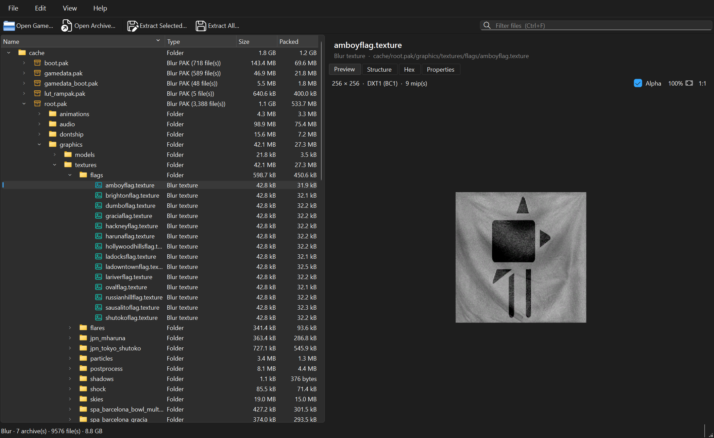
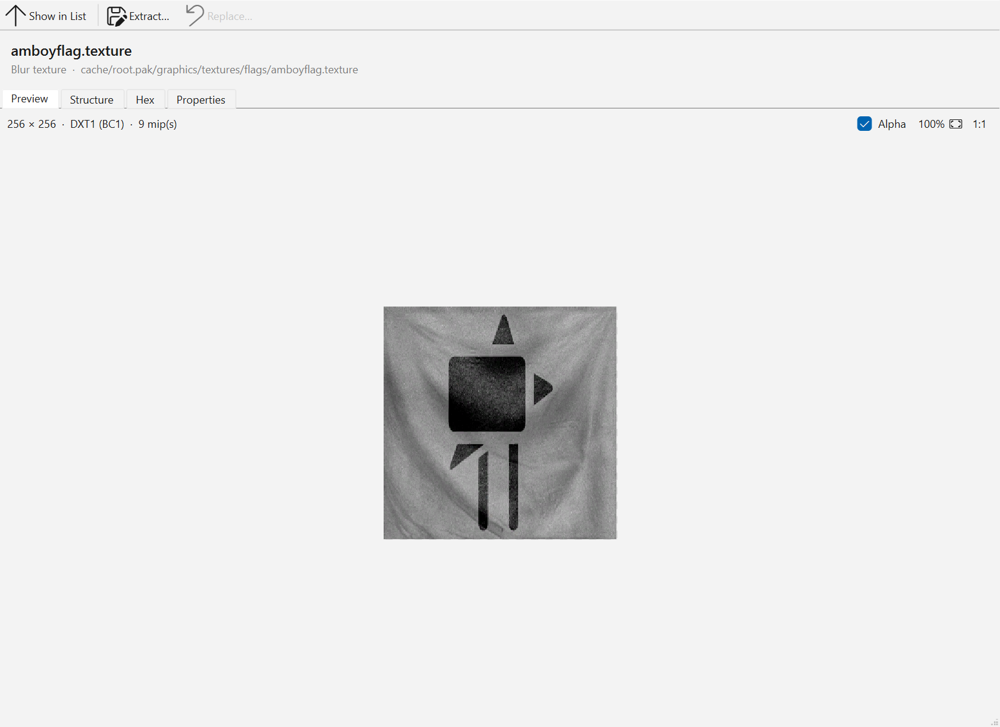

# 26Viewer

A modern, modular **game archive viewer** for Windows, written in C++23 with Qt 6.
Pick a game, point it at the install folder, and browse every packed and loose
file like in OpenIV — with texture previews, a hex view, chunk-structure inspection
and bulk extraction.

The first supported game is **Blur** (Bizarre Creations, 2010). The code is split
so that everything not specific to Blur — archive abstractions, the virtual file
system, image decoders, the UI — is shared by every future game module.

| Dark (follows Windows) | Light |
|---|---|
|  |  |

## Features

- **Game picker** at start-up: choose a game, browse to its folder, the app
  checks it really is that game's install and remembers it.
- **Explorer-style browsing** (like OpenIV / RPF Explorer): the tree on the left
  shows the install (with the game's own icon) and every archive opens like a
  folder; the list on the right shows what's inside the selected folder or
  archive. **Double-click** (or `Enter`) enters a folder or opens a file;
  **Backspace** goes up. The path bar above the list is clickable, and **search**
  (`Ctrl+F`) finds files anywhere below the open folder. *View ▸ Show Files in
  Tree* switches the tree between everything and folders/archives only.
- **Preview windows**: each file opens in its own window (several at once, any
  monitor) with Preview / Structure / Hex / Properties tabs and a toolbar for
  per-file tools (Show in List, Extract, Replace — or drop a file on the window).
- **Open alongside the game**: *Open Archive…* and *Open Folder…* add archives of
  that game, or any folder (a mod workspace, say), as extra entries at the top
  of the tree. Each game remembers its extras for next time; right-click one ▸
  *Close* to remove it.
- **Previews**: textures (DDS, BC1–BC5, raw D3D formats, Blur `.texture`), text,
  a fast hex view, a **Structure** tab for chunked formats, and a **Properties**
  tab (compression, offsets, hashes…).
  - **3D models** (Blur `.model`): orbit/pan/zoom, a parts tree to switch parts on
    and off, solid / wireframe / grid / ground shadow, and a level-of-detail picker.
  - **Audio banks** (Blur `.baf`): list every sound, play / loop / seek, export WAV,
    and (in Edit Mode) *Replace Sound…* with a `.wav` of your own.
  - **Videos** (Bink `.bik`): playback with an audio-track picker.
  - **Blur audio entities** (`audio/dat/*.dat`): decompiled to readable text — the
    game's sound logic (inputs, curves, rolloffs, sounds and their waves, mixers)
    with links resolved to component names; the Structure tab lists the components.
  - **Text** with line numbers, find, and colour coding (XML, INI, CSV, JSON, Lua,
    shaders, QuickBMS). *Edit* opens a text editor; saving goes through Edit Mode.
- **Extraction** of a selection or everything, on a background thread with
  progress and cancel; paths are sanitised so archives can never write outside
  the chosen folder.
- **Export** (`Ctrl+Alt+E`) writes *converted* copies: sound banks → a folder of
  `.wav` files, models → `.obj`, textures → `.png`, `.dds`, `.jpg` or `.bmp`
  (you choose; `.dds` keeps the game's own compressed pixels for re-importing).
- **Edit Mode** (like OpenIV): off at every start; turning it on (`Ctrl+M`)
  asks for confirmation and shows a red **EDIT MODE** badge. Only then can you:
  - **Replace assets** with your own files — *Edit ▸ Replace…* (`Ctrl+R`), the
    toolbar button, or drag a file from Explorer onto an item. The file type must
    match; the name inside the archive never changes.
  - **Import** (`Ctrl+I`) — the reverse of Export: a folder of `.wav` files
    rebuilds a sound bank (files are matched to sounds by name; missing ones stay
    as they were), and a `.png` / `.dds` / `.jpg` / `.bmp` picture becomes a
    texture, compressed to the DXT version you pick (the game's original is the
    default) with mip-maps made like the original's.
  - **Back up** explicitly: items in an archive without a backup show a red
    *"not backed up"* banner with a **Back Up Now** button (saves
    `<archive>.bak`). Replacing offers *Back Up & Replace*; nothing is backed up
    behind your back.
  - **Restore Original** from the backup.
- **Picks up where you left off**: the last game (and open folder or file) reopens at
  start-up. Toggle with *File ▸ Reopen Last Game at Startup*. Settings live in
  `%APPDATA%\26Viewer\26Viewer.ini`.
- **Modern Windows UI**: Windows 11 style, light/dark mode that follows the OS
  *live* (or forced via *View ▸ Theme*), Fluent icons, dark title bar,
  per-monitor high-DPI.
- **CLI** (`26viewer-cli`) for scripted listing, verification, extraction and
  `decompile` (audio entities → text).

## Supported games

| Game | Archives | Previews |
|---|---|---|
| Blur (PC) | `cache/*.pak` (2KAP v1 & v2: stored, zlib, chunked deflate) — read **and replace** | `.texture`, `.dds`, text, chunk structure of `.model`/`.level`/`.font`… |

Format notes live in [docs/formats/](docs/formats/).

## Quick start

Requires [MSYS2](https://www.msys2.org/) (UCRT64). Full instructions, including
the one-line package install, are in [docs/BUILDING.md](docs/BUILDING.md).

```bash
cmake --preset release
cmake --build --preset release
ctest --preset release
cmake --install build/release      # self-contained app in dist/release/
```

Run `build/release/bin/26Viewer.exe` (or `dist/release/26Viewer.exe`).

### Command line

```bash
26viewer-cli games
26viewer-cli info    "F:/Games/BLUR/cache/root.pak"
26viewer-cli list    "F:/Games/BLUR" texture
26viewer-cli verify  "F:/Games/BLUR"
26viewer-cli extract "F:/Games/BLUR/cache/root.pak" out/ graphics/textures
26viewer-cli backup  "F:/Games/BLUR/cache/root.pak"
26viewer-cli replace "F:/Games/BLUR/cache/root.pak" graphics/textures/flags/amboyflag.texture my_flag.texture
```

> **Modding note (Blur):** replaced files are written with the same checksums
> the game computes, but `gamedata*.pak` are signed (`.sig`). If the game
> rejects a modified signed archive, that is the likely reason — use
> *Restore Original* to undo.

The GUI also accepts a path (`26Viewer.exe F:\Games\BLUR`), and
`--select <virtual path> --theme dark --edit-mode --screenshot out.png` for scripted UI captures.

## Project layout

```
26Viewer/
├─ CMakeLists.txt, CMakePresets.json   build entry points
├─ cmake/            build helpers (warnings, game module selection, deployment)
├─ src/
│  ├─ core/          game-agnostic library (no Qt): archives, VFS, decoders, registries
│  ├─ games/
│  │  └─ blur/       Blur module: PAK reader, chunk files, textures
│  ├─ cli/           26viewer-cli
│  └─ app/           Qt 6 desktop application
├─ resources/        icons
├─ tests/            Catch2 unit tests (synthetic archives, no game data needed)
├─ tools/
│  ├─ research/      Python prototypes used to reverse-engineer formats
│  └─ icongen/       build-time SVG → .ico renderer for the .exe icon
├─ docs/             architecture, building, roadmap, format specs
├─ build/            (generated, git-ignored)
└─ dist/             (generated, git-ignored) deployable app folders
```

Read [docs/ARCHITECTURE.md](docs/ARCHITECTURE.md) for how the pieces fit, and
[docs/ROADMAP.md](docs/ROADMAP.md) for what comes next.

## Adding a game

1. Create `src/games/<name>/` with a `CMakeLists.txt` building `viewer_game_<name>`.
2. Implement `viewer::Game` and `void viewer::games::<name>::registerModule(GameRegistry&)`.
3. Add `<name>` to `VIEWER_GAMES` (`cmake --preset release -DVIEWER_GAMES="blur;<name>"`).

The step-by-step version is in [docs/ARCHITECTURE.md](docs/ARCHITECTURE.md#adding-a-game).

## Legal

This tool reads files from games you own. It contains no game data; never commit
extracted assets to the repository.

Licensed under the [MIT License](LICENSE).
